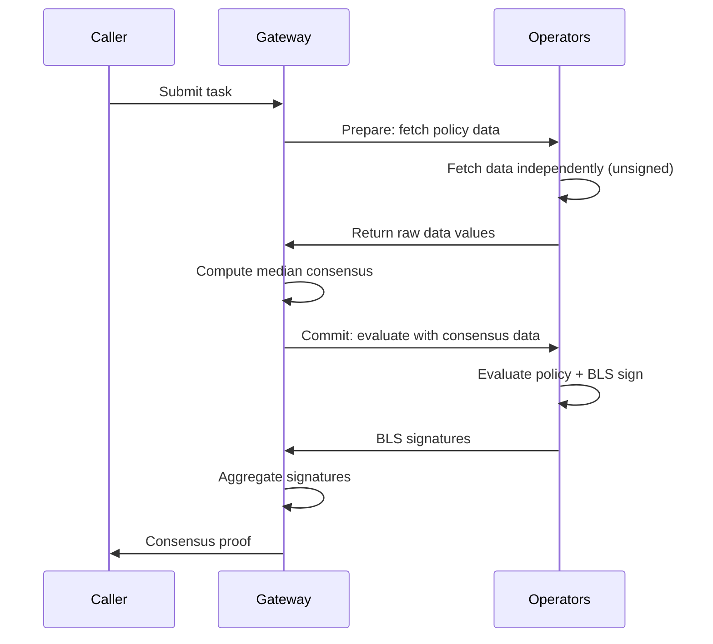

import { Card } from 'vocs'


# Consensus & Security [Newton Protocol consensus mechanisms, BLS aggregation, and economic security model. How EigenLayer restaking secures policy evaluation for blockchain compliance and risk management.]

Newton Protocol uses BLS signature aggregation and EigenLayer restaked ETH to provide cryptographic and economic security for policy evaluations.

## Two-Phase Consensus (Prepare-Commit)

Newton uses two-phase consensus to handle data variance when operators independently fetch time-sensitive data (e.g., prices from external APIs). All operators end up signing the same message despite receiving slightly different values.



1. **Prepare phase:** Gateway sends `newt_fetchPolicyData` to operators. Each operator fetches external data independently and returns **unsigned** responses.
2. **Consensus computation:** Gateway computes median values across all operator responses and verifies tolerance (default 10%).
3. **Commit phase:** Gateway broadcasts the canonical consensus data via `newt_evaluateAndSign`. Operators evaluate the policy using identical data and BLS-sign the result.
4. **Aggregation:** Gateway collects BLS signatures until quorum is reached and produces the aggregate proof.

### Threshold Decryption

Identity, confidential, and ephemeral data are encrypted to a threshold key. Each operator holds one share of it, and any `t` of the `n` shares are enough to decrypt. Decryption happens inside the two phases:

1. **Prepare phase:** Each operator computes a partial decryption of every encrypted input, with a DLEQ proof that the partial matches the operator's public share, and encrypts the partial separately to each peer operator. To collect the `t` partials that decryption needs, the Gateway raises the Prepare quorum to at least `t/n` of operator stake.
2. **Commit phase:** The Gateway relays the encrypted partials to the operators. It cannot read them and never decrypts. Each operator checks the proof on every partial it receives, combines at least `t` valid partials, decrypts, and evaluates the policy before signing.

## Median Consensus

For data oracles that return numeric values (e.g., price feeds), Newton uses **median consensus** with a configurable tolerance:

1. Each operator fetches data independently during the Prepare phase
2. The Gateway collects all responses and computes the median for each numeric field
3. If any operator's value exceeds the tolerance threshold from the median, consensus **fails** and the task returns a gateway error
4. If all values are within tolerance, the Gateway normalizes responses to use median values

```
Operator 1: price = 100.0
Operator 2: price = 102.0
Operator 3: price = 101.0

Median: 101.0
Tolerance: 10%

All within |value - median| / median <= 10% → Consensus value: 101.0
```

:::note
Values outside the tolerance fail the task with a gateway error. Operators are not silently excluded.
:::

## Configuration Parameters

| Parameter | Default | Description |
|-----------|---------|-------------|
| `prepare_timeout_ms` | 30000 | Prepare phase timeout in milliseconds |
| `evaluate_timeout_ms` | 15000 | Commit phase timeout in milliseconds |
| `consensus_tolerance_pct` | 10 | Tolerance percentage for median consensus (integer) |
| `quorum_threshold_percentage` | 67 | Minimum percentage of operator stake that must sign, sized for Byzantine fault tolerance. A request that asks for less is raised to this minimum |
| `quorum_number` | `"00"` | Quorum numbers to use (hex bytes) |

## BLS Signature Aggregation

Newton uses the **alt_bn128** curve (EIP-196/EIP-197) for BLS signature aggregation. This is the curve supported by Ethereum's pairing precompiled contracts, enabling efficient on-chain verification.

### How It Works

1. Each operator holds a BLS private key registered with the AVS
2. Operators sign the [consensus digest](#consensus-digest) with their individual key (on destination chains, the EIP-712 digest of a `BN254Certificate` whose `messageHash` is the consensus digest)
3. The Gateway aggregates individual signatures into a single aggregate signature
4. The on-chain verifier validates the aggregate signature against the registered operator set

### Consensus Digest

BLS aggregation requires all operators to sign the **exact same message**. Each operator BLS-signs the consensus digest, `keccak256(abi.encode(taskResponse))`, so every signer must produce a byte-identical `TaskResponse`.

When an aggregated response is recorded for a task, the task manager stores two hashes:

| Hash | Value | Read with |
|------|-------|-----------|
| **Task response hash** | `keccak256(abi.encode(taskResponse, responseCertificate))` | `taskResponseHash(taskId)`, or the SDK's `getTaskResponseHash` |
| **Normalized task response hash** | `keccak256(abi.encode(taskResponse))` | `normalizedTaskResponseHash(taskId)` |

The normalized hash leaves out the response certificate, so it can be compared with the hash `AttestationValidator` records for a directly verified response. `challengeDirectlyVerifiedMismatch` uses it as the canonical side of that comparison.

## Security Model

### Economic Security

Newton's security is backed by EigenLayer restaked ETH:

- Operators must stake ETH (via EigenLayer restaking) to participate
- Malicious behavior (incorrect evaluations) can be proven and results in **slashing** of staked ETH
- The economic cost of attacking the network exceeds the potential gain
- On mainnet, the operator set is permissioned: only vetted operators on the Newton operator allowlist can register, and the allowlist changes only through epoch governance

### Challenge Window

After an attestation is submitted on-chain, there is a challenge window during which the result can be disputed:

- Anyone can submit a challenge proving an operator's evaluation was incorrect
- If the challenge succeeds, the operators that signed the response are slashed on the source chain (destination chains have no slashing)
- The ChallengeVerifier records the task as challenged (`isTaskChallenged(taskId)` returns `true`), the Task Manager emits `TaskChallengedSuccessfully`, and the task's attestation no longer validates

### Slashing Conditions

Operators can be slashed for:

| Violation | Description |
|-----------|-------------|
| **Incorrect evaluation** | Signing a result that provably contradicts the policy |

### Privacy Guarantees

- Only hashes and commitments go on-chain — no PII or sensitive data
- PolicyData oracle secrets are encrypted with HPKE
- Intent details are visible to operators during evaluation but not stored permanently

## Error Handling

Consensus and aggregation failures reach the caller as gateway errors. See [Error Codes](/developers/reference/rpc-api#error-codes) for each variant and its HTTP status.

## Next Steps

<Card icon="globe" to="/developers/concepts/multichain" title="Multichain Support">
  How Newton works across multiple chains
</Card>
<Card icon="building" to="/developers/concepts/architecture" title="Architecture">
  Full system architecture overview
</Card>
