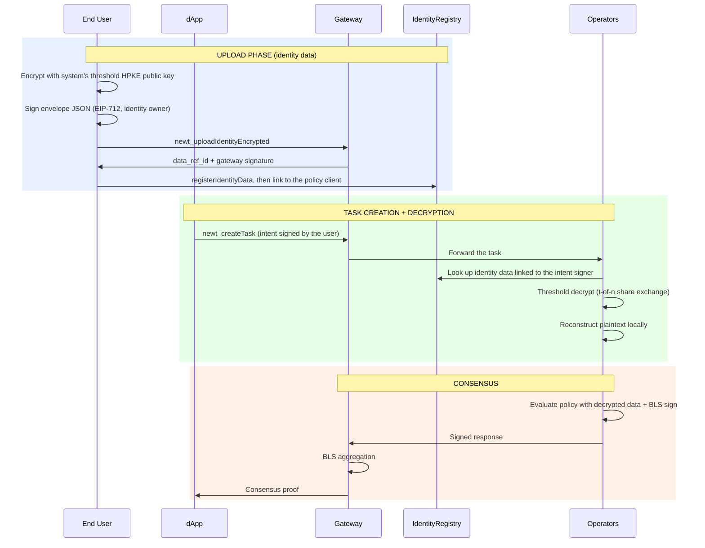

import { Card } from 'vocs'


# Privacy Layer [Newton Protocol privacy architecture — HPKE encryption, secure envelopes, and confidential policy evaluation. Private transactions with verifiable compliance for institutional and enterprise use cases.]

Newton's privacy layer enables end users to submit encrypted sensitive data (PII, credentials, financial records) that operators threshold-decrypt during policy evaluation. The data never appears on-chain.

## Overview

Many policies require access to sensitive data — identity documents, API keys, compliance records, or proprietary parameters. Newton's privacy layer provides:

- **End-to-end encryption** of sensitive inputs using HPKE (X25519/ChaCha20-Poly1305)
- **Threshold decryption** — operators collectively decrypt data using t-of-n key shares; no single party ever holds the full decryption key
- **Zero on-chain exposure** — only hashes and commitments go on-chain, never plaintext data
- **Onchain authorization**: operators use identity data only for an intent signer linked to the policy client in the IdentityRegistry, and confidential data only for a policy client its provider granted access in the ConfidentialDataRegistry

## How It Works



You encrypt each kind of private data with the key from `newt_getPrivacyPublicKey`, then hand it over on its own path. [Privacy Flows](/developers/guides/privacy-flows) walks through all three:

1. **Identity data**: the user uploads it with `newt_uploadIdentityEncrypted`, registers the returned reference in the IdentityRegistry, and links it to the policy client
2. **Confidential data**: a provider uploads it with `newt_uploadConfidentialData`, publishes the reference in the ConfidentialDataRegistry, and grants policy clients access
3. **Ephemeral data**: the client puts base64-encoded envelopes in the task's `wasm_args`, under `_newton.privacy`

## HPKE Encryption

Newton uses the HPKE standard (RFC 9180) with the following cipher suite:

| Component | Algorithm |
|-----------|-----------|
| KEM | DHKEM(X25519, HKDF-SHA256) |
| KDF | HKDF-SHA256 |
| AEAD | ChaCha20-Poly1305 |

HPKE Base mode encrypts data to the system's threshold X25519 public key. This key is produced via interactive DKG (distributed key generation) across the operator set, so no single operator holds the full private key. The gateway authenticates an identity upload by the identity owner's EIP-712 signature over the envelope JSON; it does not check the Ed25519 signature that `createSecureEnvelope` returns.

## SecureEnvelope Structure

Encrypted data is wrapped in a `SecureEnvelope`:

```json
{
  "enc": "<hex-encoded HPKE encapsulated key>",
  "ciphertext": "<hex-encoded HPKE ciphertext + Poly1305 tag>",
  "policy_client": "0x<policy client address>",
  "chain_id": 11155111,
  "recipient_pubkey": "<hex-encoded X25519 key the envelope was encrypted to>"
}
```

| Field | Description |
|-------|-------------|
| `enc` | 32-byte X25519 ephemeral public key for HPKE decapsulation (hex) |
| `ciphertext` | HPKE ciphertext including the ChaCha20-Poly1305 authentication tag (hex) |
| `policy_client` | 0x-prefixed EVM address of the target PolicyClient |
| `chain_id` | Chain ID for context binding |
| `recipient_pubkey` | The X25519 public key the envelope was encrypted to (hex). The gateway defines this field as the recipient's Ed25519 key, but no gateway path reads it |

**AAD construction:** The additional authenticated data is `keccak256(abi.encodePacked(policy_client_bytes, chain_id_be_bytes))`. This binds the ciphertext to a specific PolicyClient and chain — tampering with either field causes decryption to fail.

## Threshold Decryption

Newton distributes the HPKE private key across operators using interactive DKG (FROST DKG / Pedersen VSS). During task evaluation:

1. Each operator computes a **partial decryption share** from its DKG key share
2. Operators exchange shares via encrypted NATS messages
3. Each operator **reconstructs the plaintext locally** from t-of-n shares
4. The reconstructed plaintext is used for policy evaluation and BLS signing

The threshold keypair is cryptographically independent from operators' ECDSA and BLS keys — a compromised signing key does not yield a decryption share. The combined public key is stored on-chain and readable via a single contract call (`getThresholdPublicKey()`), or via the `newt_getPrivacyPublicKey` RPC method.

DKG ceremonies run only during operator set changes, not per-task.

## Authorization

Operators decrypt only data authorized for the task's policy client:

- **Identity data**: the IdentityRegistry must link the policy client to the intent signer, which operators recover from `intent_signature` under the policy client's EIP-712 domain. Without a signature that recovers to `intent.from`, operators skip identity data.
- **Confidential data**: the provider must grant the policy client access in the ConfidentialDataRegistry. The provider calls `proposeGrant`, then the policy client's owner calls `acceptGrant`.
- **Ephemeral data**: each envelope's `policy_client` and `chain_id` must match the task, or the gateway rejects the task.

The gateway has no dual-signature path: `newt_createTask` takes no `encrypted_data_refs`, `user_signature` or `app_signature`, and ignores them if sent.

## RPC Methods

:::note
These RPC methods are under active development and not yet available in production. The API surface may change.
:::

### `newt_getPrivacyPublicKey`

Retrieves the system's threshold HPKE public key for encrypting data.

```json
{
  "jsonrpc": "2.0",
  "method": "newt_getPrivacyPublicKey",
  "params": {},
  "id": "7ca6621b-7aa4-4bb7-a896-1f2b58a18c78"
}
```

Returns:

```json
{
  "jsonrpc": "2.0",
  "result": {
    "public_key": "<hex-encoded X25519 public key (32 bytes)>",
    "key_type": "x25519",
    "encryption_suite": "HPKE-Base-X25519-HKDF-SHA256-ChaCha20Poly1305"
  },
  "id": "7ca6621b-7aa4-4bb7-a896-1f2b58a18c78"
}
```

### Upload methods

The gateway has no `newt_uploadEncryptedData` method. Upload identity data with [`newt_uploadIdentityEncrypted`](/developers/reference/rpc-api#newt_uploadidentityencrypted) and confidential data with [`newt_uploadConfidentialData`](/developers/reference/rpc-api#newt_uploadconfidentialdata). Each returns a `data_ref_id`, the keccak256 hash of the envelope JSON, that you register onchain.

## Using Privacy in Tasks

Identity data needs only a valid `intent_signature` on the task, and confidential data nothing: operators find both through the registries. Ephemeral data goes inline in `wasm_args`; see [Ephemeral Privacy Data](/developers/guides/privacy-flows#3-ephemeral-privacy-data-per-task-inline).

For stored secrets (API keys for PolicyData oracles), see [Encrypting Secrets](/developers/advanced/encrypting-secrets).

## Use Cases

| Use Case | What's Encrypted |
|----------|-----------------:|
| **KYC-gated DeFi** | Government ID, proof of address |
| **Compliance checking** | Financial records, tax documents |
| **Private credential verification** | API keys, OAuth tokens, signed attestations |
| **Institutional policy enforcement** | Internal risk scores, portfolio data |
| **Privacy-preserving allowlists** | Membership proofs, signed approvals |

## Security Properties

| Threat | Mitigation |
|--------|------------|
| Unauthorized decryption | Operators use identity data only for a linked intent signer and confidential data only for a granted policy client |
| Single point of trust | Threshold decryption — no single operator holds the full private key |
| Ciphertext tampering | AEAD (ChaCha20-Poly1305) detects any modification |
| Context rebinding | AAD binds ciphertext to specific `policy_client` + `chain_id` |
| Key compromise | DKG key shares are cryptographically independent from ECDSA/BLS keys |
| Data persistence | TTL-based expiration with automatic cleanup |

## Next Steps

<Card icon="shield" to="/developers/concepts/consensus-security" title="Consensus & Security">
  BLS aggregation and the economic security model
</Card>
<Card icon="key" to="/developers/advanced/encrypting-secrets" title="Encrypting Secrets">
  Store encrypted secrets for PolicyData oracles
</Card>
