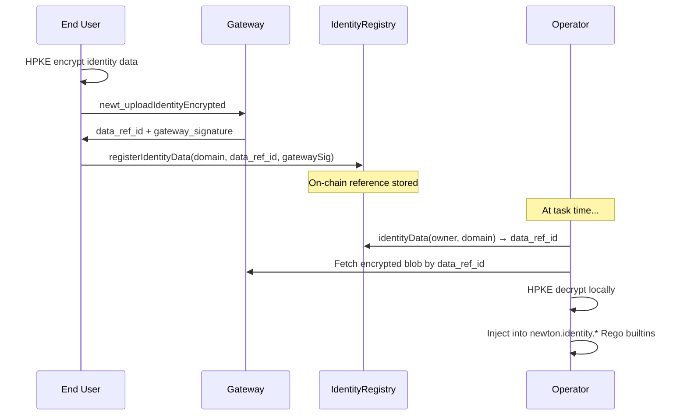
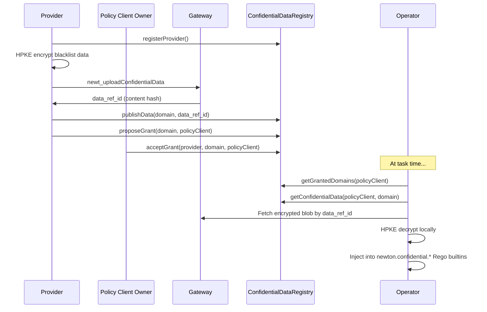

import { Card } from 'vocs'


# Privacy Flows [Three modes of privacy-preserving data in Newton Protocol — identity, confidential, and ephemeral — with end-to-end integration examples]

Newton supports three distinct privacy data flows, each designed for a different use case. All three use HPKE encryption (X25519 + ChaCha20-Poly1305). The gateway stores identity and confidential data in its `encrypted_data_refs` table; ephemeral data travels inline in the task and is not stored. The flows differ in who uploads data, how it's referenced, and which Rego namespace it appears in.

## At a Glance

| Flow | Who Uploads | Lifecycle | On-Chain Contract | Rego Namespace | SDK Method |
|------|------------|-----------|-------------------|----------------|------------|
| **Identity** | End user | Persistent, registered on-chain | `IdentityRegistry` | `newton.identity.*` | `registerIdentityData` |
| **Confidential** | Provider | Persistent, versioned, granted per client | `ConfidentialDataRegistry` | `newton.confidential.*` | `uploadConfidentialData` |
| **Ephemeral** | Client (per-task) | Single task only | None | `data.privacy.*` | Inline in `wasm_args` |

---

## 1. Identity Data (User-Uploaded)

For long-lived user data like KYC credentials, identity documents, or verifiable credentials. The user encrypts and uploads once, registers a reference on-chain, and operators decrypt it at task time for any policy that requires identity verification.

### Flow



### Integration Steps

1. **Encrypt and upload** identity data to the gateway. The gateway stores the encrypted blob and returns a `data_ref_id` (content hash) plus an EIP-712 co-signature.

2. **Register on-chain** by calling `IdentityRegistry.registerIdentityData(domain, data_ref_id, gatewaySig, deadline)`. The gateway signature prevents impersonation.

3. **Link to a policy client** by calling `IdentityRegistry.linkIdentityAsSignerAndUser(policyClient, identityDomains)` from the wallet that registered the data. The caller becomes both the identity owner and the client user, so the policy can look up the user's identity data at task time.

4. **Write a Rego policy** that uses `newton.identity.*` builtins:

```rego
package kyc_gate

default allow := false

allow if {
    newton.identity.kyc.check_approved()
    newton.identity.kyc.age_gte(18)
    newton.identity.kyc.address_in_countries(["US", "CA", "GB"])
}
```

### SDK Usage

```ts twoslash
import { createWalletClient, http } from 'viem'
import { privateKeyToAccount } from 'viem/accounts'
import { sepolia } from 'viem/chains'
import { newtonWalletClientActions, registerIdentityData, identityDomainHash, linkIdentityAsSignerAndUser } from '@newton-xyz/sdk'
// ---cut---
async function registerAndLink() {
  const client = createWalletClient({
    account: privateKeyToAccount('0x' + '1'.repeat(64) as `0x${string}`),
    chain: sepolia,
    transport: http(),
  }).extend(newtonWalletClientActions({
    apiKey: 'test-api-key',
    policyContractAddress: '0x1234567890123456789012345678901234567890',
  }))

  // Step 1: Upload is handled by the newton-identity popup (not the SDK)
  // Step 2: Register on-chain
  await registerIdentityData(client, {
    identityDomain: identityDomainHash('kyc'),
    dataRefId: 'content-hash-from-upload',
    gatewaySignature: '0x' + '0'.repeat(130) as `0x${string}`,
    deadline: 1735689600n, // Unix timestamp as bigint
  })

  // Step 3: Link to policy client
  await linkIdentityAsSignerAndUser(client, {
    policyClient: '0x1234567890123456789012345678901234567890' as `0x${string}`,
    identityDomains: [identityDomainHash('kyc')],
  })
}
```

See [Verified Credentials](/developers/verified-credential/overview) for the full identity integration guide.

---

## 2. Confidential Data (Provider-Managed)

For provider-managed datasets like blacklists, allowlists, or sanctions lists. A provider encrypts and uploads the data, publishes a versioned reference on-chain, and grants access to specific policy clients. When a provider updates the data, they publish a new version — all granted clients automatically see the latest version.

### Flow



### Integration Steps

1. **Register as a provider** by calling `ConfidentialDataRegistry.registerProvider()` (self-registration, no gatekeeping).

2. **Encrypt and upload** via the SDK:

```ts twoslash
import { uploadConfidentialData } from '@newton-xyz/sdk'
// ---cut---
async function upload() {
  const result = await uploadConfidentialData(
    11155111, // chainId
    'your-api-key',
    {
      provider: '0x1234567890123456789012345678901234567890' as `0x${string}`,
      domain: '0xdcd1e65cf8c4991fe5ed1f5f784041f7f8d1093fa81d48c3bf286ea0c78f49be' as `0x${string}`, // keccak256("newton.confidential.blacklist")
      plaintext: {
        addresses: ['0x1111111111111111111111111111111111111111', '0x2222222222222222222222222222222222222222'],
      },
      chainId: 11155111,
    },
  )
  // result.data_ref_id → use this for publishData
}
```

3. **Publish on-chain** by calling `ConfidentialDataRegistry.publishData(domain, dataRefId)`. Each call increments the version.

4. **Grant access** per policy client in two steps. The provider calls `ConfidentialDataRegistry.proposeGrant(domain, policyClient)`, which reverts unless the policy client is registered in the PolicyClientRegistry. Then the policy client's owner (its `getOwner()`) calls `acceptGrant(provider, domain, policyClient)`.

5. **Write a Rego policy** using `newton.confidential.*` builtins. Operators load every domain granted to the policy client (`getGrantedDomains(policyClient)`), so the policy takes no domain parameter. Only data published under `keccak256("newton.confidential.blacklist")` or `keccak256("newton.confidential.allowlist")` (or `keccak256("blacklist")` / `keccak256("allowlist")`) reaches the `blacklist.*` and `allowlist.*` builtins. A policy reads any other domain's top-level fields with `newton.confidential.get(field)`:

```rego
package sanctions_check

default allow := false

# Deny if sender is on the provider's blacklist
allow if {
    not newton.confidential.blacklist.contains(input.from)
}
```

### Access Control

The provider proposes and revokes per-client access, and the policy client's owner accepts it:

| Method | Description |
|--------|-------------|
| `proposeGrant(domain, policyClient)` | Provider: propose access for a registered policy client |
| `acceptGrant(provider, domain, policyClient)` | Policy client owner: accept a pending grant |
| `revokeClient(domain, policyClient)` | Revoke a specific client's access |
| `revokeGlobal(domain)` | Revoke all clients from a domain |
| `getProviders(policyClient, domain)` | List all providers that granted access |
| `hasGrant(provider, domain, policyClient)` | Check if a specific grant exists |

### Versioning

Each `publishData` call creates a new version. Operators always resolve the latest version via `getConfidentialData`. There is no explicit version pinning — all granted clients see the most recent data.

---

## 3. Ephemeral Privacy Data (Per-Task Inline)

For data that should only exist for a single task evaluation — no upload step, no on-chain registration. The client embeds encrypted data directly in the task request's `wasm_args`.

### How It Works

The following JSON is one decoded `wasm_args` entry, not the top-level task request. Encode each entry and keep its policy position in the `wasm_args` array.

The client places each HPKE `SecureEnvelope` in the reserved `_newton.privacy` array as a base64 string of the envelope's JSON:

```json
{
  "base_symbol": "ETH",
  "_newton": {
    "privacy": ["<base64 of the SecureEnvelope JSON>"]
  }
}
```

Each string decodes to an envelope like this one. Build it with [`createSecureEnvelope`](/developers/reference/sdk-reference#createsecureenvelope) and base64-encode `JSON.stringify(result.envelope)`:

```json
{
  "enc": "...",
  "ciphertext": "...",
  "policy_client": "0x...",
  "chain_id": 11155111,
  "recipient_pubkey": "..."
}
```

The gateway rejects the task with `InvalidRequest` when an entry's `_newton.privacy` array holds more than 10 envelopes, when a string is not base64 of envelope JSON, or when an envelope's `policy_client` or `chain_id` does not match the task. If the array holds envelope objects instead of strings, the gateway ignores the whole `_newton` object without an error.

Operators decrypt each envelope locally and add its JSON plaintext to `data.privacy.inline` for Rego, in envelope order. An envelope that does not decrypt to JSON is skipped, so `data.privacy.inline[i]` is the envelope at index `i` only when every envelope before it decrypted. Your PolicyData WASM never sees `_newton`: operators remove it from the WASM input.

### When to Use

- One-time privacy data that doesn't need to be stored or reused
- Testing and development before committing to the persistent upload flow
- Data that changes every transaction (e.g., real-time portfolio snapshots)

### Differences from Persistent Flows

| Aspect | Ephemeral | Persistent (Identity/Confidential) |
|--------|-----------|-----------------------------------|
| Storage | None (inline in request) | Gateway database |
| On-chain | None | `IdentityRegistry` or `ConfidentialDataRegistry` |
| Reusability | Single task only | Referenced by any future task |
| Authorization | Part of task request | Onchain link to the policy client and an intent signed by the identity owner (identity), or a two-step grant (confidential) |
| Rego namespace | `data.privacy.inline[i]` | `newton.identity.*` or `newton.confidential.*` |

---

## Encryption Primer

All three flows use the same HPKE encryption scheme:

| Component | Algorithm |
|-----------|-----------|
| KEM | X25519-HKDF-SHA256 |
| KDF | HKDF-SHA256 |
| AEAD | ChaCha20-Poly1305 |

The gateway's HPKE public key is available via `newt_getPrivacyPublicKey` or through the SDK:

```ts twoslash
import { getPrivacyPublicKey } from '@newton-xyz/sdk'
// ---cut---
async function getKey() {
  const { public_key } = await getPrivacyPublicKey(11155111, 'your-api-key')
}
```

Encryption is always client-side. The `SecureEnvelope` binds ciphertext to a specific `policy_client` and `chain_id` via AAD (additional authenticated data), preventing replay across different policy contexts.

---

## Rego Namespace Summary

| Namespace | Access Pattern | Data Source |
|-----------|---------------|-------------|
| `newton.identity.kyc.*` | Domain-specific builtins | `IdentityRegistry` (user identity) |
| `newton.identity.get(field)` | Generic field accessor | Any identity domain |
| `newton.confidential.blacklist.*` | `contains(address)`, `count()` | `ConfidentialDataRegistry` (provider blacklists) |
| `newton.confidential.allowlist.*` | `contains(address)`, `count()` | `ConfidentialDataRegistry` (provider allowlists) |
| `newton.confidential.get(field)` | Generic field accessor | Any granted confidential domain |
| `data.privacy.inline[i]` | Plain Rego data | `_newton.privacy` envelopes in `wasm_args` |
| `newton.time.*` | Date arithmetic | Reference dates in policy data |

See the [Rego Syntax Guide](/developers/advanced/rego-syntax-guide) for the full builtin reference.

## Next Steps

<Card icon="shield" to="/developers/concepts/privacy-layer" title="Privacy Layer Architecture">
  HPKE encryption, threshold decryption, and the security model
</Card>
<Card icon="user" to="/developers/verified-credential/overview" title="Verified Credentials">
  Full identity data integration with the newton-identity popup
</Card>
<Card icon="code" to="/developers/advanced/rego-syntax-guide" title="Rego Syntax Guide">
  All Newton Rego extensions including privacy and time builtins
</Card>
