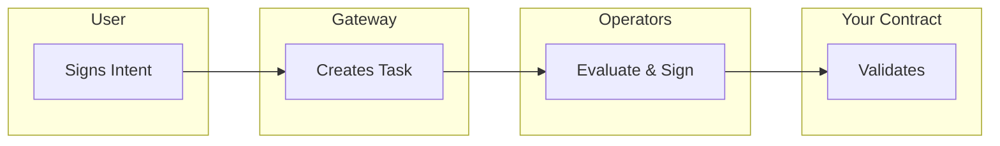

import { Card,Tabs,Tab } from 'vocs'


# Smart Contract Integration [Add policy-based transaction authorization to your Solidity contracts. Deploy a PolicyClient that validates BLS attestation proofs before executing transactions.]

This guide shows how to integrate Newton attestation validation into your smart contracts. You will inherit from `NewtonPolicyClient`, configure validation, and manage your policy lifecycle.

## Overview

Newton provides the `NewtonPolicyClient` Solidity mixin that handles:
- Attestation validation (standard and direct methods)
- Policy configuration and parameter management
- Onchain ownership and version compatibility

### When to Use

| Use Case | Example |
|----------|---------|
| Transaction authorization | Wallet contracts requiring policy approval |
| Spend limits | Daily/weekly transfer limits on treasury contracts |
| Allowlist/blocklist enforcement | Restricting interactions to approved addresses |
| Time-based access control | Operations only allowed during certain hours |
| Complex business logic | Multi-condition approval workflows |
| Offchain data verification | Price feeds, identity verification, compliance checks |

## Core Concepts

Before writing code, understand the key data structures your contract will work with.

### Intent

An [Intent](/developers/reference/glossary#intent) describes the transaction a user wants to execute:

```solidity
struct Intent {
    address from;              // Sender: msg.sender, or the signer when a delegator submits
    address to;                // Target contract
    uint256 value;             // ETH value
    bytes data;                // ABI-encoded calldata
    uint256 chainId;           // Chain ID for cross-chain safety
    bytes functionSignature;   // Human-readable function signature
}
```

### Attestation

An [Attestation](/developers/reference/glossary#attestation) is cryptographic proof that Newton operators evaluated a policy and approved the Intent:

```solidity
struct Attestation {
    bytes32 taskId;            // Unique task identifier
    bytes32 policyId;          // Policy that was evaluated
    address policyClient;      // Your contract address
    uint32 expiration;         // Block number when attestation expires
    Intent intent;             // The approved intent
    bytes intentSignature;     // User's signature on the intent
}
```

### Task Lifecycle



1. **User signs Intent** — creates and signs an Intent describing the desired transaction
2. **Task created** — the Gateway creates a task on the TaskManager contract
3. **Operators evaluate** — operators fetch the policy, evaluate it, and BLS-sign the result
4. **Aggregator collects** — signatures are aggregated until quorum is reached
5. **Contract validates** — your contract validates the attestation and executes the transaction

## Quick Start

<Tabs>
  <Tab title="New Contract">

### Create the Foundry project

```bash
mkdir newton-policy-wallet && cd newton-policy-wallet
forge init --no-git
git init
forge install newt-foundation/newton-contracts
```

### Write the contract

Create `src/NewtonPolicyWallet.sol`:

```solidity
// SPDX-License-Identifier: MIT
pragma solidity ^0.8.27;

import {NewtonPolicyClient} from "newton-contracts/src/mixins/NewtonPolicyClient.sol";
import {INewtonProverTaskManager} from "newton-contracts/src/interfaces/INewtonProverTaskManager.sol";

contract NewtonPolicyWallet is NewtonPolicyClient {
    event Executed(address indexed to, uint256 value, bytes data, bytes32 taskId);
    error InvalidAttestation();
    error ExecutionFailed();

    address constant NEWTON_TASK_MANAGER = 0xecb741F4875770f9A5F060cb30F6c9eb5966eD13;

    constructor(address owner) {
        _initNewtonPolicyClient(NEWTON_TASK_MANAGER, owner);
    }

    function supportsInterface(bytes4 interfaceId) public view override returns (bool) {
        return super.supportsInterface(interfaceId);
    }

    function validateAndExecuteDirect(
        address to,
        uint256 value,
        bytes calldata data,
        INewtonProverTaskManager.Task calldata task,
        INewtonProverTaskManager.TaskResponse calldata taskResponse,
        bytes calldata signatureData
    ) external returns (bytes memory) {
        require(
            _validateAttestationDirect(task, taskResponse, signatureData),
            InvalidAttestation()
        );

        // Bind every executed field to the signed intent.
        require(to == taskResponse.intent.to, "Target mismatch");
        require(value == taskResponse.intent.value, "Value mismatch");
        require(keccak256(data) == keccak256(taskResponse.intent.data), "Calldata mismatch");
        (bool success, bytes memory result) = to.call{value: value}(data);
        if (!success) revert ExecutionFailed();

        emit Executed(to, value, data, task.taskId);
        return result;
    }

    receive() external payable {}
}
```

The `NEWTON_TASK_MANAGER` constant should use the `NewtonProverTaskManager` address for your target network. See [Contract Addresses](/developers/reference/contract-addresses) for the current deployed addresses.

### Configure foundry.toml

:::warning
You **must** set `via_ir = true`. The newton-contracts library requires IR-based compilation. Without it, compilation fails.
:::

```toml
[profile.default]
src = "src"
out = "out"
libs = ["lib"]
solc = "0.8.27"
via_ir = true
optimizer = true
optimizer_runs = 200

remappings = [
    "newton-contracts/=lib/newton-contracts/",
    "forge-std/=lib/forge-std/src/"
]

fs_permissions = [{ access = "read", path = "./policy_params.json" }]

[rpc_endpoints]
sepolia = "${RPC_URL}"
```

  </Tab>
  <Tab title="Existing Contract">

Add Newton attestation validation to an existing contract by inheriting `NewtonPolicyClient`. Initialization is deferred to a post-deployment admin function.

```solidity
// SPDX-License-Identifier: MIT
pragma solidity ^0.8.27;

import {NewtonPolicyClient} from "newton-contracts/src/mixins/NewtonPolicyClient.sol";
import {NewtonMessage} from "newton-contracts/src/core/NewtonMessage.sol";
import {INewtonProverTaskManager} from "newton-contracts/src/interfaces/INewtonProverTaskManager.sol";
import {OwnableUpgradeable} from "@openzeppelin-upgrades/contracts/access/OwnableUpgradeable.sol";

contract MyExistingVaultV2 is OwnableUpgradeable, NewtonPolicyClient {
    error InvalidAttestation();
    error PolicyClientAlreadyInitialized();

    bool private _newtonPolicyClientInitialized;

    // ... existing contract storage and functions remain unchanged ...

    /// @notice Initialize Newton policy client support (one-time, post-upgrade)
    function initializeNewtonPolicyClient(
        address policyTaskManager,
        address policyClientOwner
    ) external onlyOwner {
        require(!_newtonPolicyClientInitialized, PolicyClientAlreadyInitialized());
        _initNewtonPolicyClient(policyTaskManager, policyClientOwner);
        _newtonPolicyClientInitialized = true;
    }

    // The owner calls inherited setPolicies(specs) after deploying the policies.

    /// @notice Add policy-protected functionality
    function protectedWithdraw(
        NewtonMessage.Attestation calldata attestation
    ) external {
        require(_validateAttestation(attestation), InvalidAttestation());
        // Execute withdrawal logic...
    }

    function supportsInterface(bytes4 interfaceId) public view override returns (bool) {
        return super.supportsInterface(interfaceId);
    }
}
```

:::warning
When adding `NewtonPolicyClient` to an existing upgradeable contract:
- Add new storage variables at the end to avoid layout conflicts
- The `_newtonPolicyClientInitialized` flag prevents re-initialization
- Test thoroughly on a fork before mainnet deployment
- Consider using a timelock or multisig for the initialization call
:::

Install the dependency:

```bash
forge install newt-foundation/newton-contracts
```

  </Tab>
</Tabs>

## Validation Methods

Newton provides two validation methods for different use cases.

### Standard Validation

```solidity
function _validateAttestation(
    NewtonMessage.Attestation memory attestation
) internal returns (bool);
```

The standard method validates against an attestation that the Newton aggregator has already submitted onchain via `respondToTask`. It verifies:
1. Policy ID matches your contract's configured policy
2. `msg.sender` is the intent sender (`from`), or an approved delegator relaying an intent that `from` signed (see [Delegated Intents](/developers/guides/delegated-intents))
3. Chain ID matches the current chain
4. Attestation hash matches stored hash, is not expired, and has not been spent

### Direct Validation

```solidity
function _validateAttestationDirect(
    INewtonProverTaskManager.Task calldata task,
    INewtonProverTaskManager.TaskResponse calldata taskResponse,
    bytes calldata signatureData
) internal returns (bool);
```

Direct validation verifies BLS signatures onchain without waiting for the aggregator to call `respondToTask`. It performs the same policy/sender/chain checks, plus onchain BLS signature verification and quorum checks.

### Comparison

| Aspect | `_validateAttestation` | `_validateAttestationDirect` |
|--------|------------------------|------------------------------|
| **Prerequisite** | `respondToTask` called | None: the task does not need to exist onchain |
| **Gas Cost** | ~50,000 - 100,000 | ~200,000 - 500,000 (BLS verification) |
| **Latency** | Wait for aggregator | Immediate |
| **Parameters** | Attestation only | Task + Response + Signatures |
| **Use Case** | Standard flow | Time-sensitive operations |

Direct validation is recommended for most use cases as it avoids waiting for the aggregator and works with the `evaluateIntentDirect` SDK method.

## API Reference

### Policy-set interface

```solidity
struct PolicySpec {
    address policy;
    INewtonPolicy.PolicyConfig config;
}

function setPolicies(PolicySpec[] calldata policies) external returns (bytes32);
function getPolicies() external view returns (PolicySpec[] memory);
function getPolicyId() external view returns (bytes32);
function policyRevision() external view returns (uint64);
function getPolicySetSnapshot() external view returns (bytes32, uint64, PolicySpec[] memory);
function getNewtonPolicyTaskManager() external view returns (address);
function getOwner() external view returns (address);
```

`setPolicies` is owner-only and atomically replaces the complete ordered set. Each entry has its own `policyParams` bytes and nonzero `expireAfter` in blocks. Repeated addresses remain separate entries: never sort or deduplicate the set.

Use `getPolicySetSnapshot()` to read the ID, revision, and specs together. Separate reads can straddle an owner update. The getter is `getPolicyId()`, not `policyId()`.

| Mixin function | Purpose |
|---|---|
| `_initNewtonPolicyClient(taskManager, owner)` | Initialize TaskManager and owner |
| `_initPolicies(specs)` | Initial configuration; an empty list defers configuration |
| `_setPolicies(specs)` | Internal complete-set replacement; protect any custom wrapper |
| `_policies()` / `_policyId()` | Internal reads of configured specs / set ID |
| `setPolicyClientOwner(newOwner)` | Owner-only authority transfer |

An unconfigured client is not ready to authorize actions. The pinned mixin rejects an empty replacement, more than 8 policies, unregistered policies, zero expiration, and policy parameters over 65,536 bytes. It checks `isPolicy(address)` on the TaskManager's configured factory. It does **not** perform the old factory semantic-version comparison in `_setPolicies`.

## Deployment

Create `script/Deploy.s.sol`:

```solidity
// SPDX-License-Identifier: MIT
pragma solidity ^0.8.27;

import {Script, console} from "forge-std/Script.sol";
import {NewtonPolicyWallet} from "../src/NewtonPolicyWallet.sol";

contract DeployScript is Script {
    function run() external {
        uint256 deployerPrivateKey = vm.envUint("PRIVATE_KEY");
        address owner = vm.addr(deployerPrivateKey);

        vm.startBroadcast(deployerPrivateKey);

        NewtonPolicyWallet wallet = new NewtonPolicyWallet(owner);

        console.log("Deployed at:", address(wallet));
        vm.stopBroadcast();
    }
}
```

:::warning
The PolicyClient must point at the Task Manager the gateway responds to: `0xecb741F4875770f9A5F060cb30F6c9eb5966eD13` on Sepolia. Attestations are recorded only there, so on the standard path validating against any other address reverts with `AttestationHashMismatch()`.
:::

### Configure the policy set

Deploy two independent policies, then have the client owner submit one configuration transaction. This example uses empty JSON parameters; replace them with each policy's schema-valid configuration.

```solidity
import {INewtonPolicyClient} from "newton-contracts/src/interfaces/INewtonPolicyClient.sol";
import {INewtonPolicy} from "newton-contracts/src/interfaces/INewtonPolicy.sol";

// Inside the owner's Foundry broadcast script:
INewtonPolicyClient.PolicySpec[] memory specs = new INewtonPolicyClient.PolicySpec[](2);
specs[0] = INewtonPolicyClient.PolicySpec({
    policy: firstPolicy,
    config: INewtonPolicy.PolicyConfig({policyParams: bytes("{}"), expireAfter: 25})
});
specs[1] = INewtonPolicyClient.PolicySpec({
    policy: secondPolicy,
    config: INewtonPolicy.PolicyConfig({policyParams: bytes("{}"), expireAfter: 25})
});
bytes32 newPolicyId = client.setPolicies(specs);
```

Choose each expiration for your application's block-time and authorization window; 25 is illustrative. For exact `cast` configuration and readback commands, see [Deploying with CLI](/developers/guides/deploying-with-cli#step-6--bind-policy-and-parameters).

### Replace a set on the same client

Call `setPolicies` again with the entire desired list, including unchanged entries. Every successful replacement increments the revision, even an identical replacement. The ID commits to a domain separator, chain, client address, revision, and ordered specs. Reordering also changes the ID.

Old attestations become unusable when their ID no longer matches the client's ID. Refresh application configuration and request a new evaluation after replacement. Changing policies on a policy-set-capable client does not require deploying another client; upgrading a legacy client implementation is a separate migration.

The Task freezes `policies`, `policyRevision`, and `policyId` at admission. Preserve that snapshot and the signed response unchanged when submitting direct validation.

## PolicyClientRegistry

The `PolicyClientRegistry` is a central onchain directory of approved policy client contracts. Registration is required for policy clients that participate in the identity linking flow via `IdentityRegistry`.

### Why Register?

| Benefit | Description |
|---------|-------------|
| Identity linking | `IdentityRegistry` enforces that only registered clients can have user identity data linked |
| Discoverability | `getClientsByOwner()` enables enumeration of all clients owned by an address |
| Lifecycle management | Deactivate/reactivate clients without re-deploying |
| Ownership transfer | Transfer the registry record to a new owner |

### Registration

Only the policy client's owner can register it, and the caller becomes the registered owner:

```solidity
// Called by the client's owner (getOwner() == msg.sender)
policyClientRegistry.registerClient(address(myPolicyClient));
```

Requirements:
- The client contract must implement `INewtonPolicyClient` (verified via ERC-165)
- The caller must be the client's owner, or the call reverts with `NotClientOwner`
- Each client can only be registered once

### Managing Client Status

```solidity
// Deactivate a client (prevents new identity links)
policyClientRegistry.deactivateClient(address(myPolicyClient));

// Reactivate
policyClientRegistry.activateClient(address(myPolicyClient));

// Transfer ownership of the registry record
policyClientRegistry.setClientOwner(address(myPolicyClient), newOwnerAddress);
```

### CLI Management

All registry operations are available via `newton-cli policy-client`:

```bash
# Register a client (opens the dashboard; run newton-cli login first)
newton-cli --chain-id 11155111 policy-client register \
  --registry 0x0dbd6e44a1814f5efe4f67a00b7f28642e3064dd --client 0x... --rpc-url $RPC

# Check registration status
newton-cli policy-client status \
  --registry 0x0dbd6e44a1814f5efe4f67a00b7f28642e3064dd --client 0x... --rpc-url $RPC

# List clients by owner
newton-cli policy-client list \
  --registry 0x0dbd6e44a1814f5efe4f67a00b7f28642e3064dd --owner 0x... --rpc-url $RPC

# Deactivate / activate / transfer ownership
newton-cli policy-client deactivate \
  --registry 0x0dbd6e44a1814f5efe4f67a00b7f28642e3064dd --client 0x... --private-key $KEY --rpc-url $RPC
newton-cli policy-client activate \
  --registry 0x0dbd6e44a1814f5efe4f67a00b7f28642e3064dd --client 0x... --private-key $KEY --rpc-url $RPC
newton-cli policy-client transfer-ownership \
  --registry 0x0dbd6e44a1814f5efe4f67a00b7f28642e3064dd --client 0x... --new-owner 0x... --private-key $KEY --rpc-url $RPC
```

### IdentityRegistry Integration

The `IdentityRegistry` reads the `PolicyClientRegistry` address from the `NewtonAddressesProvider` passed to its constructor. Every `_linkIdentity()` call checks `IPolicyClientRegistry.isRegisteredClient()` on the target policy client and reverts with `PolicyClientNotRegistered` if the client is not registered or has been deactivated.

Deployment lifecycle:

1. Deploy `PolicyClientRegistry` and initialize it
2. Deploy `IdentityRegistry` with a `NewtonAddressesProvider` that returns the registry, then call `initialize()`. The constructor reverts with `InvalidClientRegistryAddress()` if the provider returns no registry
3. Register approved policy clients via `registerClient()`
4. Any identity linking attempt against an unregistered or deactivated client reverts

## Version Compatibility

This guide targets the documented policy-set contracts. Use the dependency above with the deployed addresses for your target network.

Check the client interface, TaskManager, configured policy factory, gateway schema, and SDK together. A CLI version or an onchain `version()` string alone does not prove ABI compatibility.

The owner can replace policies only with policies registered by the TaskManager's configured factory. Verify provenance with `isPolicy(policy)`. Preserve the inherited `supportsInterface` implementation instead of hardcoding the old single-policy interface ID. Legacy clients need an implementation upgrade or replacement before they expose `setPolicies`; do not send this call to a single-policy client.

## Common Patterns

### Decode Intent Data

Extract function arguments from the attestation:

```solidity
function decodeTransferIntent(
    NewtonMessage.Attestation calldata attestation
) internal pure returns (address to, uint256 amount) {
    // Skip the function selector (4 bytes)
    (to, amount) = abi.decode(
        attestation.intent.data[4:],
        (address, uint256)
    );
}
```

### Verify Function Selector

Ensure the attestation is for the expected function:

```solidity
bytes4 selector = bytes4(attestation.intent.data[:4]);
require(selector == IMyContract.expectedFunction.selector, "Wrong function");
```

### Execute Raw Intent

Execute the intent exactly as specified with error bubbling:

```solidity
function executeIntent(
    NewtonMessage.Attestation calldata attestation
) internal returns (bytes memory) {
    require(_validateAttestation(attestation), "Invalid attestation");

    (bool success, bytes memory returnData) = attestation.intent.to.call{
        value: attestation.intent.value
    }(attestation.intent.data);

    if (!success) {
        if (returnData.length > 0) {
            assembly {
                revert(add(32, returnData), mload(returnData))
            }
        }
        revert("Execution failed");
    }

    return returnData;
}
```

### Multi-Attestation Batching

Process multiple attestations in one transaction:

```solidity
function batchExecute(
    NewtonMessage.Attestation[] calldata attestations
) external returns (bool[] memory results) {
    results = new bool[](attestations.length);

    for (uint256 i = 0; i < attestations.length; i++) {
        require(_validateAttestation(attestations[i]), "Invalid attestation");
        results[i] = _executeAction(attestations[i]);
    }
}
```

## Security Considerations

### Always Validate Before Execution

Never execute business logic before validation completes:

```solidity
// CORRECT
function withdraw(NewtonMessage.Attestation calldata attestation) external {
    require(_validateAttestation(attestation), "Invalid");  // Validate first
    _transfer(attestation.intent.to, attestation.intent.value);  // Then execute
}

// WRONG - DO NOT DO THIS
function withdraw(NewtonMessage.Attestation calldata attestation) external {
    _transfer(attestation.intent.to, attestation.intent.value);  // Executes before validation!
    require(_validateAttestation(attestation), "Invalid");
}
```

### Built-in Safety Checks

The `NewtonPolicyClient` mixin automatically enforces:

- **Sender verification**: `msg.sender` must be `attestation.intent.from`, or an approved delegator carrying `from`'s signature over the intent (prevents user A from using user B's attestation)
- **Chain ID verification**: `attestation.intent.chainId == block.chainid` (prevents cross-chain replay attacks)
- **Expiration**: `block.number < attestation.expiration` (attestations expire after the configured block window)
- **Replay protection**: each attestation can only be used once (marked as "spent" after validation)

### Additional Best Practices

- Always verify function selectors match expectations when decoding intent data
- Set appropriate `expireAfter` values — too short and users cannot execute; too long and the security window increases
- Protect the `policyClientOwner` key with a multisig or timelock
- Preserve the inherited `supportsInterface` implementation for the pinned interface
- Fund the contract with ETH if it needs to execute value transfers

## Troubleshooting

| Error | Cause | Resolution |
|-------|-------|------------|
| `InvalidAttestation()` | The validation call returned `false`: the task was challenged, or on the direct path the policy denied the intent | For a denial, read the per-policy results; otherwise request a fresh attestation |
| `AttestationHashMismatch()` | No matching attestation is recorded on the configured Task Manager: wrong Task Manager address, the response is not onchain yet, or the policy denied the intent (a denial records no attestation) | Verify the Task Manager address matches the [Sepolia deployment](/developers/reference/contract-addresses), wait for the task to be responded, and check the per-policy results |
| `ExecutionFailed()` | The target call reverted | Debug the target transaction independently |
| `PolicyNotRegistered` | Policy is not registered with the configured factory | Verify `policyFactory()` and `isPolicy(policy)` |
| `PolicyClientNotRegistered` | Client not registered in `PolicyClientRegistry` | Register via `registerClient()` or CLI `newton-cli policy-client register` |
| `Unauthorized("Policy ID does not match")` | Attestation's policy ID differs from configured policy | Read `getPolicySetSnapshot()` and request a fresh attestation after replacement |
| `Unauthorized("Not authorized intent sender")` | `msg.sender` is neither `attestation.intent.from` nor an approved delegator | Have `intent.from` call the function, or relay it through an approved delegator |
| `Unauthorized("Delegator required")` | The client requires a delegator and `intent.from` called directly | Submit through an approved delegator |
| `Unauthorized("Missing intent signature")`, `Unauthorized("Invalid intent signature")` | A delegator call carried no signature, or one that does not recover to `intent.from` | Have `intent.from` sign the intent; see [Delegated Intents](/developers/guides/delegated-intents) |
| `Unauthorized("Intent already used")` | A delegator already spent this signed intent | Sign and submit a new intent |
| `Unauthorized("Chain ID does not match")` | Attestation created for a different chain | Ensure the intent specifies the correct `chainId` |
| `AttestationExpired()` | `block.number >= attestation.expiration` | Request a new attestation; consider increasing `expireAfter` |
| `AttestationAlreadySpent()` | Attestation has already been used | Each attestation is single-use; request a new one |
| `InterfaceNotSupported` | The client does not report `INewtonPolicyClient` through ERC-165 | Override `supportsInterface` and call `super.supportsInterface(interfaceId)` |
| Stack too deep | Missing `via_ir = true` | Add `via_ir = true` to foundry.toml |

See [Error Reference](/developers/reference/error-reference) for the full list of Newton error codes.

## Next Steps

<Card icon="window" to="/developers/guides/frontend-sdk-integration" title="Frontend SDK Integration">
  Build a frontend that submits tasks and executes attested transactions
</Card>
<Card icon="code" to="/developers/reference/sdk-reference" title="SDK Reference">
  Full TypeScript SDK documentation
</Card>
<Card icon="file-code" to="/developers/reference/contract-addresses" title="Contract Addresses">
  Deployed Newton contract addresses on all networks
</Card>
