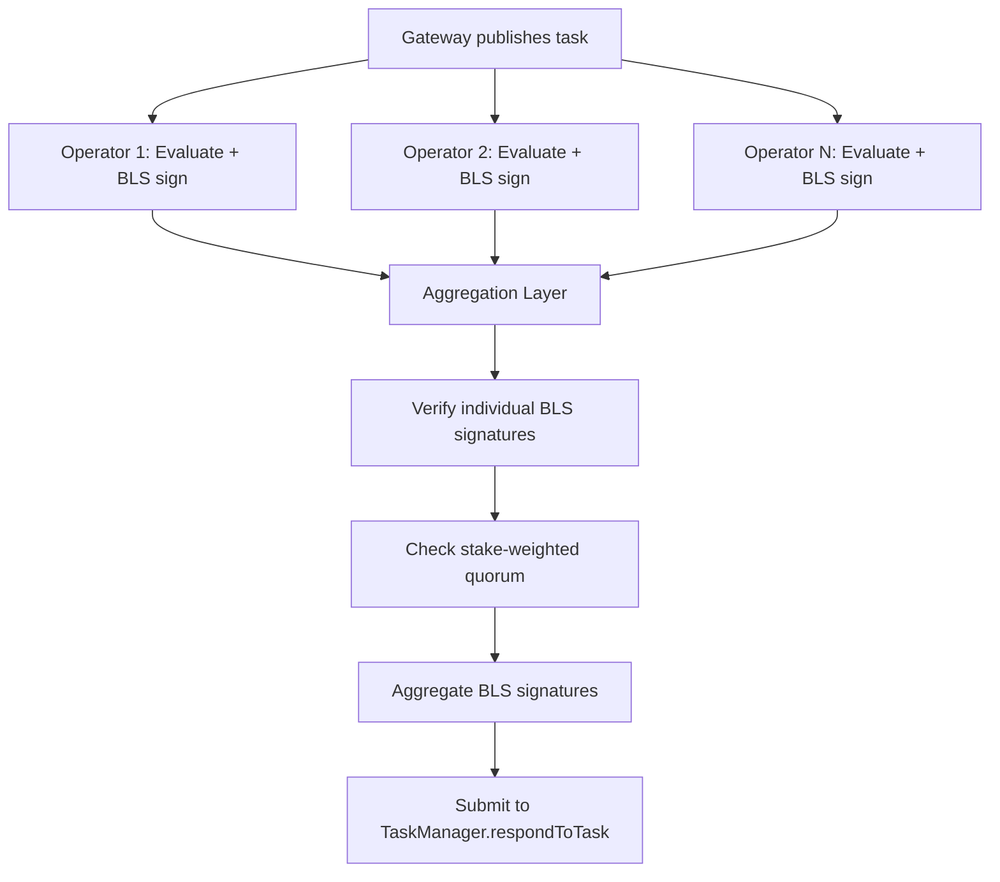

# BLS Attestation Protocol [BLS signature scheme on BN254, the consensus digest, the aggregation algorithm, and policy data attestation in the Newton Protocol.]

## BLS Attestation Protocol

Newton Protocol uses BLS (Boneh-Lynn-Shacham) signatures for operator consensus. One aggregate signature from a quorum of operators attests both a task's verdict and the policy data it was evaluated against, as a single compact proof the TaskManager verifies onchain.

### BLS Signature Scheme

Newton uses BLS signatures on the BN254 (alt_bn128) elliptic curve, chosen for its compatibility with Ethereum's precompiled contracts at addresses 0x06 (EIP-196: addition and scalar multiplication) and 0x08 (EIP-197: pairing check). Operators hold BLS private keys and register their corresponding public keys in the BLS APK registry contract.

The curve provides two groups: G1 (signatures, 32 bytes compressed) and G2 (public keys, 64 bytes compressed). The bilinear pairing function `e: G1 x G2 -> GT` enables signature aggregation: given individual signatures `sigma_1, ..., sigma_n` over the same message, the aggregate signature `sigma = sigma_1 + ... + sigma_n` can be verified against the aggregate public key `apk = pk_1 + ... + pk_n` with a single pairing check.

The onchain verification equation is:

```
e(sigma, -G2) * e(H(m), apkG2) == 1
```

Where `sigma` is the aggregated BLS signature (G1 point), `G2` is the generator of the G2 group, `H(m)` is the message hash mapped to G1 (the consensus digest), and `apkG2` is the aggregated public key in G2 queried from the BLS APK registry at the task's reference block.

For multi-quorum verification, a gamma randomization factor prevents rogue public key attacks:

```
e(sigma + gamma * apk, -G2) * e(H(m) + gamma * G1, apkG2) == 1
```

The gamma factor binds each quorum's signature to its public key, preventing an attacker from choosing a rogue public key that cancels another operator's key during aggregation.

### Consensus Digest

BLS signature aggregation requires all operators to sign the exact same message. Each operator signs the consensus digest: keccak256 over the ABI-encoded task response, computed the same way in the offchain service layer and the onchain contract library. The response carries the policy task data the policy was evaluated against, so the aggregate signature covers the data as well as the verdict. [Streaming Consensus](/whitepaper/streaming-consensus) describes how operators agree on one data set when their independent fetches differ.

The verification flow onchain proceeds through a middleware chain: the TaskManager delegates to a response handler, which computes the consensus digest and passes it to the BLS signature checker for pairing verification.

### BLS Aggregation Algorithm

The aggregation process proceeds as follows:



1. **Individual verification.** Each operator's BLS signature is verified against their registered public key before being accepted for aggregation. This prevents rogue key attacks where a malicious operator submits a crafted signature.

2. **Quorum check.** The aggregator computes the total stake of signing operators and compares it against the per-task quorum threshold percentage (0-100). The quorum check is: `signed_stake >= total_stake * quorum_threshold / 100`. The aggregator returns early once quorum is met to minimize latency.

3. **Signature aggregation.** Once quorum is reached, the BLS aggregation layer produces the aggregate signature along with non-signer stakes and signature data needed for onchain verification.

The protocol selects a reference block for aggregate public key lookups that ensures validity at onchain verification time.

### Policy Data Attestation

Policy data carries the same guarantees as the verdict. No single party supplies it: operators fetch it independently, the network agrees on one canonical set, and a quorum of operators signs that set inside the task response, which is published onchain. Newton secures this path with zero-knowledge proofs, trusted execution environments, and multi-party computation, so the data behind every decision is trust-minimized, decentralized, verifiable, transparent, and credibly neutral.
